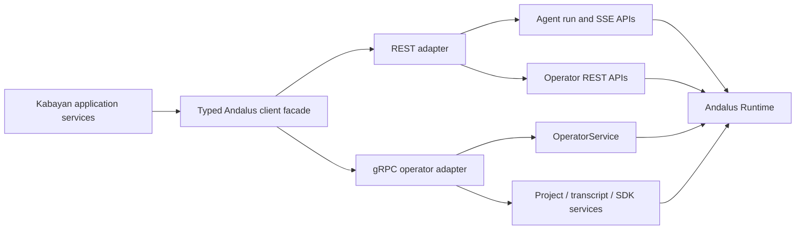

# ARIP implementation mapping — Andalus Runtime

Status: M0 implementation audit; evidence-based mapping, not a frozen public contract  
Inspected source: `andalus-ai/andalus` default branch (`main`) on 2026-11-26  
Scope: REST resources, operator REST/gRPC surfaces, selected SDK and memory classes. This is a source inspection, not a deployed-endpoint or end-to-end security test.

## 1. Executive conclusion

The current Runtime already exposes useful building blocks for a Kabayan integration:

- Agent execution and incremental output through REST.
- Session and execution inspection/control through the operator REST API and gRPC `OperatorService`.
- Capability discovery through operator REST/gRPC.
- Run interaction snapshots and event-history retrieval through REST.
- Project/session CRUD and transcript streaming through separate gRPC services.
- Memory visualization and a memory export/import service inside the Runtime codebase.

However, the inspected APIs do **not** form one uniform client-facing agent API. In particular, agent invocation is not part of the inspected `OperatorService` protobuf; project sessions and operator sessions are distinct surfaces; interaction history is not a resumable event stream; and memory visualization/export is not a Kabayan-ready personal-memory CRUD API.

**Recommendation:** implement ARIP first as a small Kabayan-owned typed Java facade that maps to verified existing endpoints. Keep transport adapters separate. Do not add an Andalus module, protobuf service, or new wire protocol during this step.

## 2. Operation-to-implementation map

| ARIP logical operation | Existing implementation found | Assessment / mapping decision |
|---|---|---|
| `session.open` | `ProjectService.CreateSession` in `andalus_api.proto`; project/session CRUD | Project-scoped session creation exists. No create operation appears in the inspected operator session REST resource or `OperatorService`. Do not assume a project session is identical to an agent conversation/session. |
| `session.get` | `GET /api/operator/v1/sessions/{sessionId}`; `OperatorService.GetSession` | Existing operator-session inspection. Identity and resource scope must be enforced by the service layer. |
| `session.close` | `POST /api/operator/v1/sessions/{sessionId}/close`; `OperatorService.CloseSession`; project-session removal is separately exposed | Close and delete/remove are different semantics. Preserve that distinction. |
| `agent.invoke` | `POST /api/v1/agents/run` via `AgentResource.run` and `AgentClient.execute` | Existing REST execution entry point. It accepts prompt, strategy, skills, timeout, session/model identifiers and a context map. No corresponding invoke RPC was found in the inspected operator protobuf. |
| `agent.stream` | `POST /api/v1/agents/stream` using Server-Sent Events and `AgentClient.execute` | Existing REST incremental-output surface. Confirm event framing, terminal/error behavior and client disconnect semantics before wrapping it. |
| `run.submit` | Agent REST `/run`; agent REST `/stream` | The request starts execution through the agent client. The source does not establish that its returned run identifier is interchangeable with every execution/operator identifier. Verify correlation before unifying types. |
| `run.observe` | `GET /api/v1/agent-interactions/{runId}` and `GET /api/v1/agent-interactions/{runId}/events`; operator execution inspection | Snapshot and history retrieval exist. The `/events` handler returns a JSON history envelope, not a streaming/resumable event feed. |
| `run.cancel` | `POST /api/operator/v1/executions/{executionId}/cancel`; `OperatorService.CancelExecution` | Existing control operation. Verify how the execution ID relates to the agent run ID returned by `AgentClient.execute`. |
| Pause/resume/retry | Operator execution REST and `OperatorService` RPCs | Existing controls beyond the original ARIP minimum. Keep them as optional run-control capabilities. |
| `capability.discover` | `GET /api/operator/v1/capabilities`, `/type/{type}`, `/tag/{tag}`; matching `OperatorService.ListCapabilities*` RPCs | Discovery/listing exists. Results are operator capability summaries; this is not proof that a capability is authorized for a particular invocation. |
| `capability.invoke` | Agent execution accepts selected skills and invokes `AgentClient.execute` | No generic direct capability-invocation operation was found in the inspected operator REST/gRPC surface. Map only after determining whether the intended call is agent-mediated, tool-mediated or a separate runtime capability API. |
| `context.resolve` | Agent request accepts a `context` map; SDK contains `AndalusContextComposer` | No dedicated context-resolution REST/gRPC operation was identified in the inspected API files. Do not invent one. Treat context composition as client-side or agent-request context until a specific runtime API is verified. |
| `approval.request/respond` | Framework execution interaction contracts include approval request/decision/store abstractions | No dedicated approval REST/gRPC endpoint was identified in the inspected API files. Determine whether approvals are delivered through the runtime interaction/event mechanism or require an existing UI/client integration before defining a remote mapping. |
| `memory.query/mutate` | Memory visualization REST/gRPC projections; Runtime memory providers and export/import service | Visualization is projection-oriented, not a general query/mutation API. Export/import exists in Runtime code, but the inspected service is not a complete personal-data lifecycle API. Kabayan should retain its own personal-memory semantics and must not treat these endpoints as ready for personal memory CRUD. |

## 3. Concrete API surfaces inspected

### 3.1 Agent execution — REST

Source: `api/andalus-api-rest/src/main/java/tech/kayys/andalus/api/rest/AgentResource.java`

- Base path: `/api/v1/agents`
- `POST /run`: invokes `AgentClient.execute(...)` and maps the result to a JSON response.
- `POST /stream`: invokes the same client with streaming enabled and emits Server-Sent Events.
- `GET /skills` and `GET /skills/{skillId}`: skill catalog.
- `GET /health`: skill health summary.

The request includes `prompt`, `systemPrompt`, `strategy`, `skills`, `maxSteps`, `timeout`, `sessionId`, `modelId` and `context`.

The resource's `trustedRequest` derives authenticated user identity from Quarkus `SecurityIdentity`, derives tenant from the trusted identity attribute, and removes identity-shaped keys (`tenantId`, `userId`, roles, permissions and principal fields) from the caller-supplied context map. An authenticated request without a trusted tenant is rejected. Anonymous behavior is a separate policy question and must not be assumed suitable for Kabayan.

### 3.2 Session and execution controls — REST and gRPC

REST resources:

- `/api/operator/v1/sessions`: list, inspect, suspend, resume and close.
- `/api/operator/v1/executions`: list, inspect, pause, resume, cancel and retry.
- `/api/operator/v1/capabilities`: list, inspect, filter by type and filter by tag.

gRPC: `api/andalus-api-grpc/src/main/proto/andalus/operator/v1/operator.proto` defines `OperatorService` with corresponding session, execution and capability RPCs.

The protobuf `OperatorRequestContext` carries correlation ID, request ID and string attributes. The gRPC context resolver derives principal and tenant from the authenticated `SecurityIdentity`, strips caller-provided identity-shaped attributes and populates roles/permissions from trusted identity attributes. The REST resolver follows the same general pattern.

These are operator APIs. The existence of a context resolver is not, by itself, proof that every deployment has authentication enabled or that every operation has the required policy configuration. Kabayan must use a correctly secured Runtime deployment and test tenant/resource isolation end to end.

### 3.3 Run interaction and lifecycle

Sources:

- `api/andalus-api-rest/src/main/java/tech/kayys/andalus/api/rest/execution/AgentInteractionRestResource.java`
- `api/andalus-api-rest/src/main/java/tech/kayys/andalus/api/rest/execution/ExecutionResource.java`
- `api/andalus-api-rest/src/main/java/tech/kayys/andalus/api/rest/execution/CheckpointResource.java`

The interaction resource exposes a run snapshot and an event-history list. The execution resource exposes state, transitions, transition history and recovery assessment/plan/execute. Checkpoint endpoints provide checkpoint persistence/inspection operations.

Do not describe `GET .../events` as a resumable stream: it returns a JSON response containing the current history. Do not promise replay cursors, retention guarantees, idempotency or cross-reconnect stream resumption until the implementation proves them.

There are several identifiers in play (`sessionId`, `runId`, `executionId`, `attemptId`, `checkpointId`). Keep them as distinct value types in Kabayan until source-level correlation and lifecycle ownership are verified.

### 3.4 gRPC boundaries

Inspected protobufs:

- `api/andalus-api-grpc/src/main/proto/andalus/operator/v1/operator.proto`
- `api/andalus-api-grpc/src/main/proto/andalus_api.proto`

The operator protobuf covers capability discovery and session/execution controls. The general API protobuf covers project/session CRUD, code generation streaming, transcript append/read streaming, SDK/model operations, knowledge services and memory visualization services.

Important distinction: `SdkService.SdkStream` streams provider/model output for an SDK session. It is not evidence of a general-purpose `agent.invoke/agent.stream` RPC. Likewise, project-session CRUD is not interchangeable with operator session lifecycle.

### 3.5 Memory surfaces and limitations

Inspected sources:

- `api/andalus-api-rest/src/main/java/tech/kayys/andalus/api/rest/MemoryVisualizationResource.java`
- `api/andalus-api-grpc/src/main/proto/andalus_api.proto` (`MemoryVisualizationService`)
- `modules/andalus-hermes/src/main/java/tech/kayys/andalus/memory/MemoryExportService.java`
- `modules/andalus-hermes/src/main/java/tech/kayys/andalus/hermes/MemoryPortabilityResource.java`

Memory visualization exposes overview, graph, vectors, working state, procedural view, timeline and full-view projections. It is not a record-level personal memory CRUD API.

The inspected REST visualization resource accepts user/tenant/workspace identifiers as query parameters and sets wildcard CORS headers. This audit did not establish the authorization behavior of every underlying projection/store. **Do not expose this surface as Kabayan's personal-memory API until server-side tenant/owner enforcement and deployment CORS policy are verified.**

The REST portability resource exposes export, import, backup and backup-list endpoints, but no deletion endpoint was found in this resource. It accepts user/tenant identifiers as query parameters for export/backup and does not itself resolve them from an authenticated principal. Import validates the snapshot agent ID against the path but does not visibly bind the snapshot to an authenticated owner/tenant in this resource. The backup endpoint accepts a caller-supplied filesystem path. Deployment-wide authentication/authorization filters may exist elsewhere, but they were not verified in this source audit; do not infer that these parameters are trusted or that the custom path is safe.

The export service aggregates records from registered providers and includes agent/user/tenant identifiers in snapshot metadata. In the inspected implementation, provider export is invoked by agent ID and provider exceptions are swallowed. That is insufficient evidence for a complete, user-scoped export/delete contract. Kabayan must not promise complete export or deletion based solely on this service.

## 4. Recommended Kabayan adapter boundary

Implement a Kabayan-owned typed facade with transport-specific adapters behind it:

The facade should initially expose only operations whose semantics are verified:

- invoke an agent and receive a typed result;
- invoke/consume the existing SSE stream with explicit terminal/error handling;
- list/inspect capabilities;
- inspect and control sessions/executions where the caller is authorized;
- retrieve run interaction snapshots/history as snapshots, not as a resumable stream.

Keep the transport choice out of Kabayan domain services. A same-JVM adapter can be added later only if a stable service boundary exists and it preserves the same security and audit behavior.

Do not yet expose generic `capability.invoke`, resumable `run.observe`, remote approval methods, context resolution or personal memory CRUD as implemented facade methods.

## 5. M0 findings and follow-up decisions

| Finding | Consequence | Required follow-up |
|---|---|---|
| Agent invoke/stream currently found in REST, not in inspected OperatorService gRPC | Remote typed client cannot assume a matching agent gRPC RPC | Decide whether REST/SSE is sufficient for M1 or whether a genuinely reusable gRPC gap exists |
| Operator sessions and project sessions are separate APIs | A single Kabayan `SessionId` abstraction may conflate distinct lifecycles | Define Kabayan conversation/session ownership and maintain explicit external ID mappings |
| Agent run, execution and attempt identifiers are distinct in source | Cancel/observe may target a different identifier than the agent invocation result | Trace ID creation/propagation through AgentClient and backend execution before binding them |
| Interaction history endpoint returns a JSON snapshot | No verified resume cursor, replay contract or backpressure behavior | Define polling/snapshot semantics for M1; defer resumable event streaming |
| Capability discovery is present, generic direct capability invocation is not established | Discovery cannot be treated as authorization or invocation | Trace agent/tool dispatch path and policy enforcement |
| Approval SPI exists but remote endpoint mapping is unverified | ARIP approval operations remain conceptual | Inspect interaction bus, approval store and UI/event integration before designing a client operation |
| Memory visualization is not CRUD and has caller-supplied scope parameters | Unsafe to treat as personal-memory API without more evidence | Audit projection/store authorization and CORS; define Kabayan memory lifecycle independently |
| Memory export service swallows provider failures and calls export by agent ID | Cannot claim complete, tenant-safe export/delete | Audit provider scope semantics; add completeness and deletion guarantees only in the owning implementation |

## 6. M1 implementation sequence

1. Trace the response types and ID propagation from `AgentResource` → `AgentClient` → execution backend.
2. Trace operator service authorization for session/execution/capability operations, including tenant/resource scope.
3. Define Kabayan's own conversation/session identity and explicit mappings to Andalus project-session and operator-session IDs.
4. Implement a narrow REST client for agent run and SSE, plus a gRPC/REST operator client only for verified controls.
5. Add contract tests for identity spoofing, tenant mismatch, unauthorized resource access, cancellation and stream termination.
6. Defer new gRPC/protobuf contracts until the REST/SSE and operator APIs are proven insufficient for a reusable first-party client.

## 7. Source inventory

- `api/andalus-api-rest/src/main/java/tech/kayys/andalus/api/rest/AgentResource.java`
- `api/andalus-api-rest/src/main/java/tech/kayys/andalus/api/rest/execution/AgentInteractionRestResource.java`
- `api/andalus-api-rest/src/main/java/tech/kayys/andalus/api/rest/execution/ExecutionResource.java`
- `api/andalus-api-rest/src/main/java/tech/kayys/andalus/api/rest/execution/CheckpointResource.java`
- `api/andalus-api-rest/src/main/java/tech/kayys/andalus/operator/rest/session/SessionOperatorResource.java`
- `api/andalus-api-rest/src/main/java/tech/kayys/andalus/operator/rest/execution/ExecutionOperatorResource.java`
- `api/andalus-api-rest/src/main/java/tech/kayys/andalus/operator/rest/capability/CapabilityOperatorResource.java`
- `api/andalus-api-rest/src/main/java/tech/kayys/andalus/operator/rest/OperatorRestContextResolver.java`
- `api/andalus-api-grpc/src/main/java/tech/kayys/andalus/api/grpc/operator/OperatorGrpcService.java`
- `api/andalus-api-grpc/src/main/java/tech/kayys/andalus/api/grpc/operator/OperatorGrpcContextResolver.java`
- `api/andalus-api-grpc/src/main/proto/andalus/operator/v1/operator.proto`
- `api/andalus-api-grpc/src/main/proto/andalus_api.proto`
- `modules/andalus-hermes/src/main/java/tech/kayys/andalus/memory/MemoryExportService.java`
