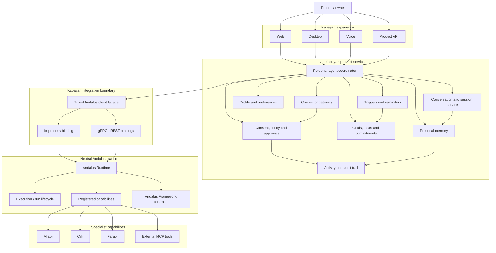
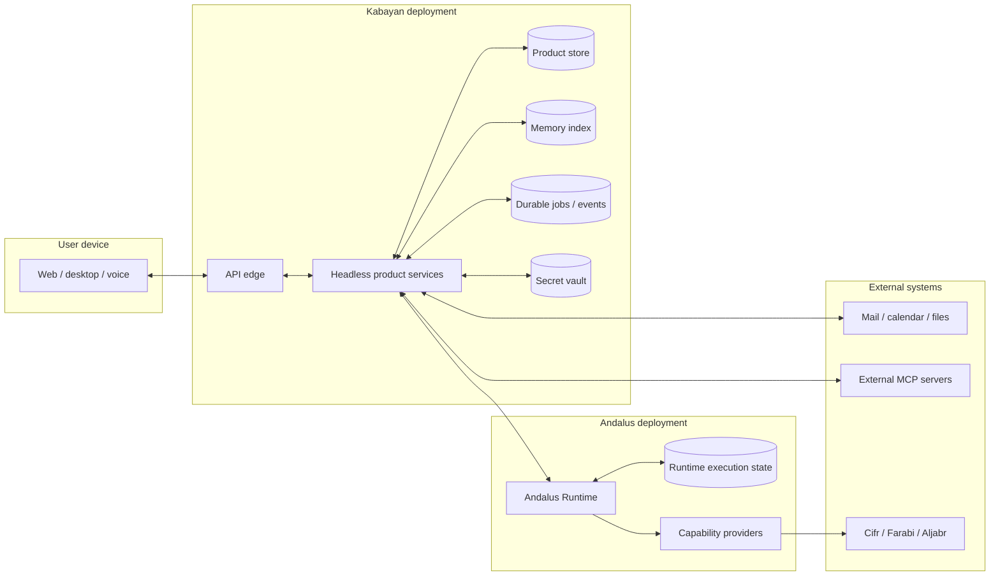
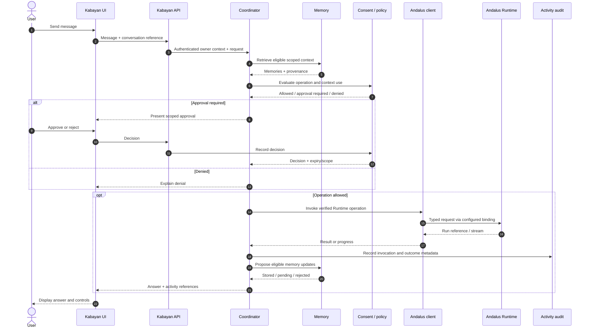
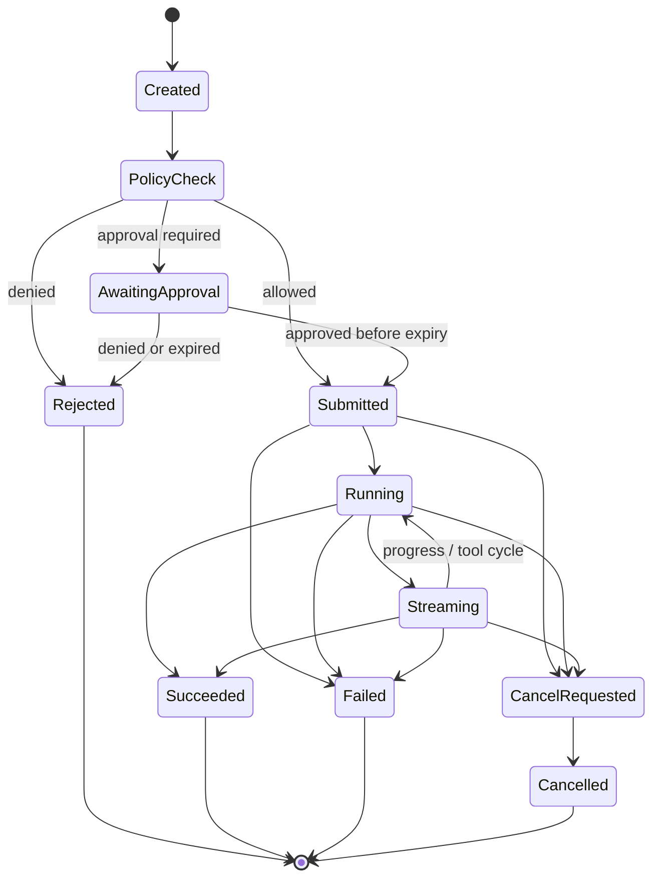
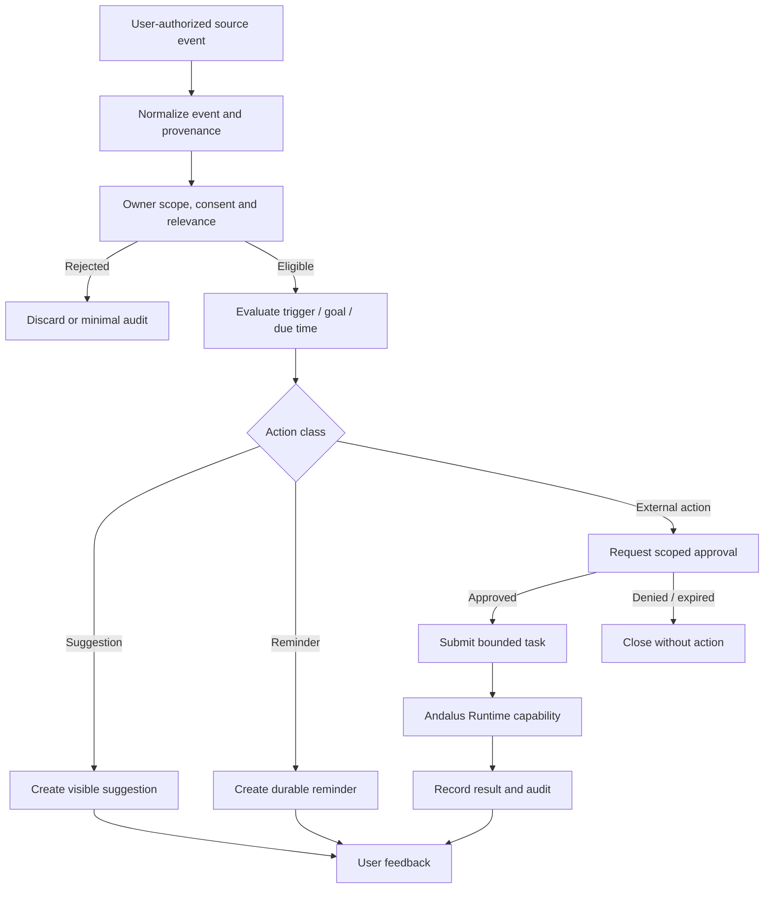
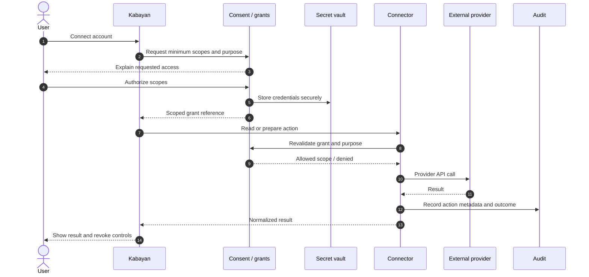

# Kabayan: Personal Agent Architecture

Status: M0 architecture baseline (proposed; implementation contracts remain subject to source verification)  
Owner: `andalus-ai/kabayan`

## 1. Mission

Kabayan is a persistent personal AI agent that helps one person understand, organize, plan and act across their digital life. It provides continuity, personal memory, proactive assistance and policy-controlled integrations.

Kabayan is a product/personal-intelligence layer, not a general-purpose agent runtime or framework. All Kabayan-specific product semantics, personal-data policy and user experience belong in this repository.

### Product principles
1. Continuity with user control.
2. Grounded personalization: distinguish user-confirmed facts, source-observed facts and model inferences.
3. Proactivity without surprise: suggestions/reminders may be proactive; consequential external actions require authorization.
4. Headless core: domain behavior does not depend on UI.
5. Explainability: expose why a memory, suggestion or action exists.
6. Least privilege and graceful degradation.

## 2. Ecosystem boundaries

| Project | Owns | Must not absorb |
|---|---|---|
| Andalus Framework | Reusable Java contracts, SPIs, communication abstractions | Kabayan product policy, personal UI/profile semantics |
| Andalus Runtime | Execution, orchestration, capability dispatch, run lifecycle, runtime policy and operations | Personal-assistant experience or personal memory policy |
| Kabayan | Personal profile, memory semantics, user experience, proactive workflows, integrations and approvals | General agent runtime, duplicate capability lifecycle or transport |
| Aljabr | Shared mathematical, statistical, ML and computational capabilities | Personal-assistant orchestration |
| Cifr / Farabi | Specialist coding and research/analytics products | Kabayan's identity and personal memory |

Kabayan consumes Andalus through the supported shared interaction boundary. **ARIP is owned/evolved separately from this Kabayan product design.** This document does not redefine its wire format, service names or transport. MCP remains for external tool interoperability, not a mandatory internal hop. A2A and ANP retain their separate agent-to-agent/network roles.

## 3. Logical architecture

The diagram expresses logical ownership, not a one-component-per-module or one-service-per-process requirement.

| Component | Owns | Does not own |
|---|---|---|
| Coordinator | Turn user intent into bounded work and coordinate Kabayan services | Reimplementing Andalus orchestration |
| Session service | Kabayan conversation/session identity and external ID mapping | Andalus execution state |
| Profile | Explicit user-provided identity, preferences and settings | Promoting inferred facts to confirmed profile |
| Memory | Capture policy, provenance, retrieval, correction and deletion | Generic runtime knowledge infrastructure |
| Planner | User goals, tasks, commitments and plans | All runtime scheduling |
| Proactive service | Trigger evaluation, suggestions and reminders | Unbounded autonomous execution |
| Connector gateway | Account connections, scopes, ingestion and actions | Treating connection as blanket consent |
| Consent/approval | Product consent UX and Kabayan policy | Duplicating Runtime authorization |
| Andalus client | Map use cases to verified runtime operations | New wire protocol or policy bypass |

## 4. Deployment topology

Constraints:
- Co-located and remote deployments must preserve equivalent authorization and audit semantics.
- Kabayan owns personal data, grants and preferences; Andalus owns runtime execution state.
- Store refresh/access tokens only in a secret store, never prompts, memory records or logs.
- Durable reminders/jobs require durable persistence, not an in-memory timer.
- Local-first is a future topology option, not an M1 assumption.

## 5. Domain model and identity

| Concept | Meaning | Authority |
|---|---|---|
| OwnerId / PersonalSpaceId | Person and personal-data isolation boundary | Kabayan identity boundary |
| ConversationId / KabayanSessionId | Conversation and continuity lifecycle | Kabayan |
| RuntimeSessionRef | External session ID plus provider and ID kind | Andalus; mapped by Kabayan |
| RunRef | External run/execution reference | Andalus; mapped by Kabayan |
| MemoryId | Retained memory item | Kabayan |
| ConnectorAccountId / GrantId | External account and scoped permission | Kabayan |
| ApprovalId | One approval lifecycle | Kabayan product domain |
| JobId | Durable proactive/scheduled work | Kabayan |

A Kabayan session is not automatically an Andalus project session or operator session. Persist an explicit mapping with external system, ID kind, owner scope, lifecycle state and mapping version. Keep run, execution, attempt and checkpoint references distinct until equivalence is proven.

Invariants:
- Every personal-data record has owner and personal-space scope.
- External IDs are namespaced by provider and resource kind.
- Caller-supplied owner/tenant values are never authentication.
- Export/deletion traverse the full owner-scoped data graph.
- Idempotency keys are scoped to owner, operation and target.

## 6. Personal memory

Kabayan owns memory meaning and lifecycle policy while reusing suitable Andalus storage/retrieval/indexing infrastructure. Four logical classes:
- **Episodic:** sourced events and interactions.
- **Semantic:** facts, entities, concepts and relationships.
- **Procedural:** preferences, habits and recurring workflows.
- **Prospective:** intentions, commitments, reminders and follow-ups.

Each record needs stable ID, owner scope, type, typed content, provenance, epistemic status (user-confirmed/source-observed/inferred/proposed), confidence, sensitivity, timestamps, retention, validity interval where relevant, retrieval policy and correction/deletion lineage. These are logical classes, not four required databases. Memory is not automatically truth; never silently promote inference to confirmed fact.

See [Personal Memory Design](PERSONAL_MEMORY.md).

## 7. Conversation and request sequence

This is conceptual. Actual API/event semantics must follow verified Runtime behavior and the separately maintained ARIP contract.

## 8. Run lifecycle

Normalize statuses for display only; retain raw external status and source IDs. Cancellation requested is not cancellation confirmed. Observer disconnect is not cancellation.

## 9. Proactive work sequence

Every durable job has owner, purpose, trigger/schedule, expiry, policy/grant reference, idempotency key, bounded retry and cancellation path. A model prediction is not consent.

## 10. Connector action sequence

Re-check grant state at action time. Never pass provider secrets through prompts or ordinary tool arguments.

## 11. Security, privacy and observability

- Authenticate at the edge; derive owner and tenant scope server-side.
- Authorize each operation against resource, purpose and current policy.
- Treat files, messages, web pages, model output and tool output as untrusted data.
- Require explicit approval for consequential actions, destructive changes and external sharing unless narrowly scoped automation exists.
- Bind approvals to action, target, parameters/content, grant, owner, expiry and bounded use; material changes invalidate approval.
- Audit access, memory mutations, approvals and external actions without logging raw content or secrets.
- Support inspect, correct, suppress, export and deletion across primary and derived data.
- Local/in-process calls receive the same policy and audit treatment.
- Propagate correlation IDs and run/job references; log operation, outcome, latency and failure category, not full prompts or personal payloads.

See [Security and Privacy](SECURITY_AND_PRIVACY.md).

## 12. Candidate module boundaries

| Candidate | Responsibility |
|---|---|
| `kabayan-core` | Domain types, owner scope and shared contracts |
| `kabayan-runtime` | Personal session lifecycle and service coordination |
| `kabayan-memory` | Capture, retrieval, consolidation and memory lifecycle |
| `kabayan-profile` | Explicit profile and preferences |
| `kabayan-planner` | Goals, tasks and commitments |
| `kabayan-proactive` | Triggers, reminders and bounded background work |
| `kabayan-connectors` | External ingestion, grants and adapters |
| `kabayan-integrations-andalus` | Typed client facade over verified Runtime operations |
| `kabayan-security` | Consent, approval, export and deletion orchestration |
| `kabayan-api` / `kabayan-app` | Product API and experience surfaces |

These are candidates, not a mandate to create empty modules. Start with the smallest coherent build; extract only when API, ownership and tests are stable.

## 13. Roadmap and dependencies

| Milestone | Outcome | Exit criteria |
|---|---|---|
| M0 Architecture | Ownership, domain, security and docs | Boundaries and non-goals reviewed |
| M1 Agent foundation | Identity, conversation/session mapping, typed Runtime client and run lifecycle | Converse, observe and cancel with distinct external IDs and tested failure semantics |
| M2 Memory | Four classes, provenance, retrieval and controls | Inspect, correct, suppress, export and delete including derived data |
| M3 Proactive | Durable triggers, reminders and bounded jobs | Consent-gated actions, deduplication, expiry, cancellation and audit |
| M4 Integrations | User-authorized connectors | Per-connector scopes, revocation and approval tested |
| M5 Experience | Web/desktop/voice, timeline and controls | User can understand and control activity and personal data |
| M6 Advanced | Multimodal and long-running workflows | Privacy, reliability and resource targets validated |

M1 establishes identity/session/run foundations. M2 needs stable owner scope and storage lifecycle. M3 depends on durable jobs and approvals. M4 can proceed incrementally after grant/secret design. M5 can evolve in parallel but does not own domain rules. M6 follows evidence from earlier milestones.

See [Implementation Roadmap](IMPLEMENTATION_ROADMAP.md).

## 14. Non-goals

- No general-purpose runtime, duplicate plugin/capability registry or transport stack in Kabayan.
- No mandatory MCP hop between Kabayan and Andalus.
- No custom wire protocol without evidence and accepted ADR.
- No Kabayan-specific changes in Andalus repositories.
- No autonomous background action without visible policy and controls.
- No silent capture of sensitive personal data.
- No premature microservices or empty modules.
- No claims that conceptual APIs or guarantees exist before implementation proves them.

## 15. M0 acceptance

- [x] Ownership and non-goals defined.
- [x] Memory classes and lifecycle principles defined.
- [x] Andalus integration defers to shared ARIP work.
- [x] Security, consent and approval invariants defined.
- [x] Architecture, deployment, sequence, state and proactive diagrams included.
- [x] Milestones and dependencies documented.
- [x] Repository guidance and docs index established.
- [ ] Verify identifier propagation, service authorization and stream semantics before freezing client contracts.
