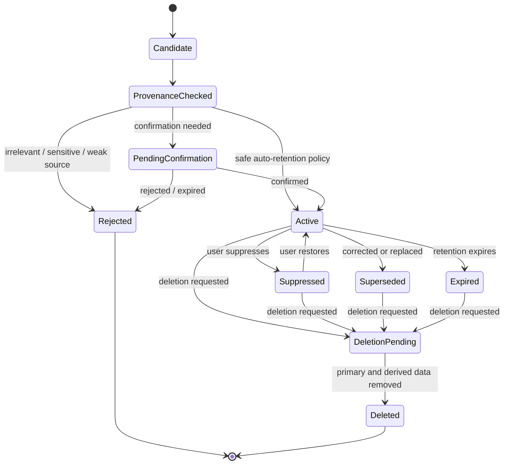
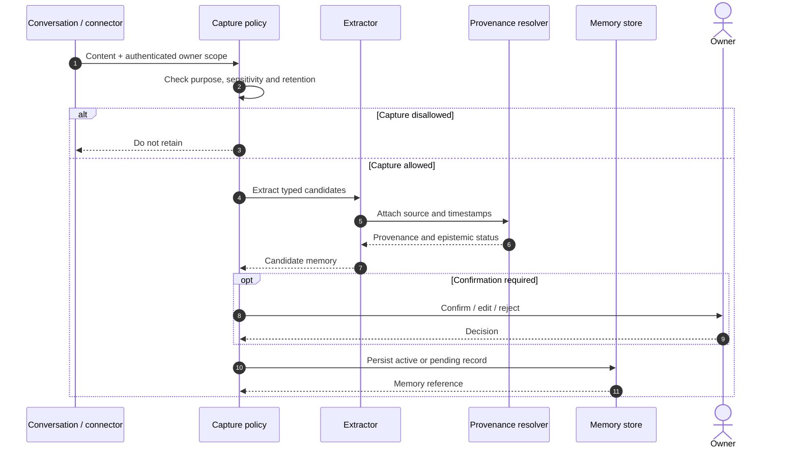
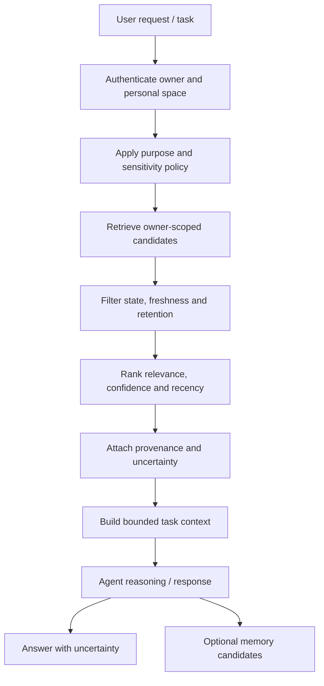
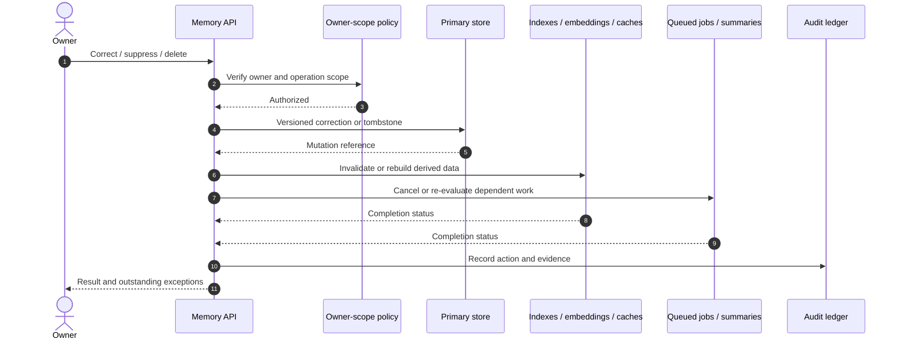

# Personal Memory Design

Status: M0 product design; implementation and storage choices remain open  
Owner: Kabayan

## 1. Purpose and ownership

Personal memory provides continuity across conversations and tasks. Kabayan owns memory semantics, user controls and personal-data lifecycle. It may reuse Andalus storage, retrieval, vector, graph or knowledge infrastructure, but those systems do not thereby own Kabayan's personal-data policy.

Memory is not a transcript dump and model-generated content is not automatically true.

## 2. Memory classes

| Class | Meaning | Examples |
|---|---|---|
| Episodic | Sourced event or interaction | Meeting occurred; decision made in a conversation |
| Semantic | Retained fact or relationship | Project uses a language; person has a stated role |
| Procedural | Preference or recurring method | Preferred report format; recurring workflow |
| Prospective | Future intention or commitment | Follow up next week; prepare proposal by a date |

These are logical classes and may share one storage model.

## 3. Conceptual memory record

A record needs typed equivalents of:
- stable `memoryId`, `ownerId`, `personalSpaceId`;
- `memoryType` and typed content;
- `epistemicStatus`: user-confirmed, source-observed, inferred or proposed;
- confidence and sensitivity;
- provenance references, source type and source timestamp;
- created/observed/updated times and optional validity interval;
- retention policy and retrieval eligibility;
- state: proposed, active, suppressed, superseded, expired or deletion-pending;
- `supersedes[]` and `derivedFrom[]` lineage.

This is a conceptual schema, not a finalized database/API. Minimize raw content and never store secrets.

## 4. Capture lifecycle

Rules:
- Discussion of a sensitive topic is not consent to retain it.
- Uncertain/consequential facts remain hypotheses or require confirmation.
- Preserve source time separately from ingestion time.
- Deduplicate without erasing distinct events or conflicting evidence.
- Conflicting facts are versioned or clarified, never silently overwritten.

## 5. Retrieval lifecycle

Apply owner scope before search, not only after global retrieval. Filter suppression, expiry, sensitivity and purpose before context assembly. Return provenance and epistemic status. Retrieval is read-only; writes follow a separate lifecycle.

## 6. Correction, suppression and deletion

- Correction creates an auditable revision.
- Suppression prevents future retrieval/proactive use.
- Deletion covers primary records, embeddings, indexes, graph edges, summaries, caches, exports under Kabayan control and queued jobs.
- If a provider cannot confirm deletion, report it; never claim full deletion.
- Restores must reapply deletion tombstones before data becomes queryable.
- Source revocation triggers review of memories derived solely from that source.

## 7. Export and retention

Export includes active/user-visible memory, profile/preferences, provenance/status, user-authored plans and reminders, connector metadata/grants (never secrets), schema version and timestamp. It is authenticated, owner-scoped, encrypted and completeness-reported. No arbitrary filesystem paths. Partial provider/store failures must be disclosed.

Classify sensitive data, minimize content, support configurable retention, separate memory retention from transcript retention, and do not use personal memory for model training without separate explicit revocable consent.

## 8. M2 work packages and acceptance

1. Owner-scoped typed model and repository contract.
2. Provenance, epistemic status, confidence and sensitivity.
3. Capture policy and confirmation workflow.
4. Scoped retrieval and filtering.
5. Consolidation, deduplication, conflicts and freshness.
6. Inspect, correct, supersede, suppress and restore.
7. Deletion across primary and derived stores.
8. Versioned export with completeness report.
9. Separate explicit profile from inferred memory.

Acceptance: user can inspect source/status, correct and suppress immediately, delete with honest completion status, and export a versioned owner-scoped archive. Isolation and derived-data deletion are tested.
