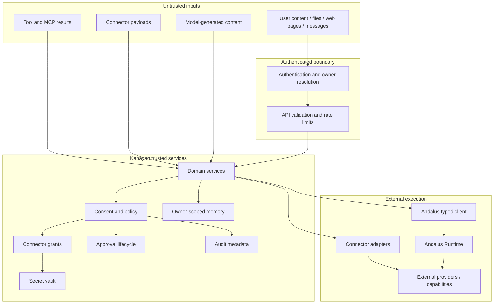
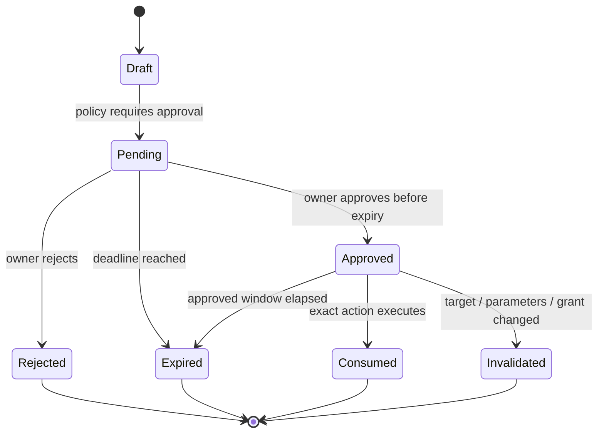
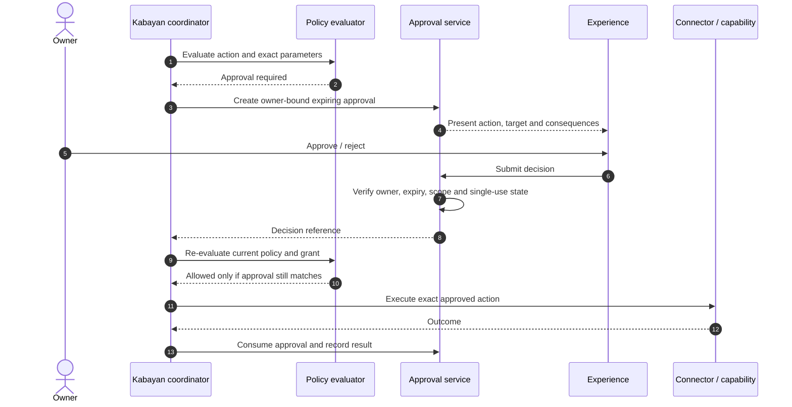

# Security and Privacy Architecture

Status: M0 baseline; controls must be verified in implementation  
Owner: Kabayan

## 1. Security objectives

Protect confidentiality/isolation of each personal space, integrity of memory and approvals, user control over capture and sharing, least-privilege external access, and accountability for decisions and side effects. Fail closed when identity, policy or provider state cannot be verified.

## 2. Trust boundaries

Untrusted content may inform an answer but cannot grant access, change consent or approve an action.

## 3. Threat model

| Threat | Example | Controls |
|---|---|---|
| Cross-owner access | Search returns another owner's memory | Server-derived owner; repository-level scope; negative tests |
| Identity spoofing | Caller supplies another owner ID | Ignore client identity fields; trusted principal |
| Prompt injection | Email asks agent to export data/send secrets | Retrieved content is data; policy outside model; action-time authorization |
| Overbroad grant | Calendar connection enables mail sending | Per-account/scope/purpose grants |
| Approval replay | Reuse approval for changed recipient/amount | Bind canonical parameters, expiry and bounded use; atomic consume |
| Stale authorization | Job runs after disconnect | Re-check grants immediately before execution |
| Log leakage | Prompt/token appears in trace | Redaction; metadata-only logging |
| Derived-data residue | Deleted item remains in vector index | Deletion graph, tombstones and invalidation |
| Unsafe export | Caller-controlled path or foreign snapshot | Owner scope, safe object storage and schema validation |
| Runaway proactive agent | Duplicate triggers/infinite retry | Durable dedupe, budgets, expiry and kill switch |
| Compromised tool | Tool returns malicious instructions | Tool output untrusted; scoped credentials and approval |
| Runtime misconfiguration | Operator API exposed without auth | Deployment hardening and end-to-end auth tests |

## 4. Identity and authorization

Resolve owner identity only from trusted authentication; map it to a Kabayan personal space. Authorize each operation by owner, resource, purpose, action and current policy. Enforce scope in the data-access layer, not only controllers. Use least-privilege service identities for backend calls. Local calls are not inherently trusted. Authentication and authorization are separate checks.

## 5. Connector grants

A grant binds owner/personal space, provider/account, exact scopes, purpose/action classes, grant source/time, expiry/revocation and secret-vault reference. Connection, ingestion and action consent are separate. Re-check grant state before every external action. Revocation stops future calls and invalidates/cancels dependent jobs.

## 6. Approval lifecycle

Bind approval to action, target, content/parameters, connector grant, owner, expiry and bounded use. Material parameter changes require new approval. Approval does not replace provider authorization.

## 7. Data lifecycle guarantees

| Operation | Minimum guarantee |
|---|---|
| Capture | Purpose and sensitivity checked before retention |
| Read/retrieval | Owner, purpose, state, sensitivity and retention enforced |
| Correction | Versioned change with provenance |
| Suppression | Excluded from retrieval and proactive use |
| Export | Authenticated, owner-scoped, encrypted, completeness-reported |
| Deletion | Primary and derived data invalidated; exceptions disclosed |
| Connector revocation | Future access stopped; dependent jobs cancelled/reviewed |
| Audit | Decision/outcome recorded without unnecessary raw content |

## 8. Audit and operations

Record actor/service reference, pseudonymous owner scope, operation/resource class/outcome, policy and approval/grant references, provider/action category, timestamp, correlation and run/job references. Never log raw tokens, secrets, full prompts, emails, documents or memory content by default.

Encrypt sensitive data, rotate credentials, secure webhooks with signatures/replay protection, use durable queues with bounded retries/dead letters, reapply deletion tombstones after backup restore, and provide user-visible activity history plus emergency pause for proactive actions.

## 9. Security acceptance tests

- Changing request parameters cannot access another owner's data.
- Missing/invalid identity fails closed.
- Prompt-injection content cannot authorize actions.
- Revoked grants block immediate and queued work.
- Approval cannot be replayed, transferred or reused after material changes.
- Expired grants/approvals are rejected.
- Local and remote calls enforce equivalent policy.
- Deletion covers indexes, embeddings, summaries, caches and queued work.
- Export cannot write arbitrary paths or include another owner's data.
- Normal logs/traces contain no secrets or raw sensitive payloads.
